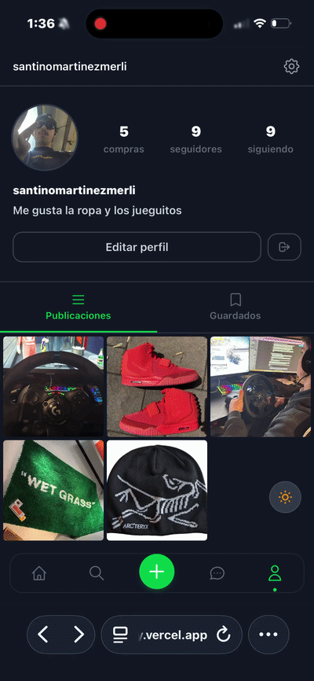

# ShareBuy 🛍️

> **Social network for sharing and reviewing purchases.**  
> Discover what people are buying, share your own finds, and connect with others through the things you love.

[](https://sharebuy.vercel.app)
[](https://react.dev)
[](https://supabase.com)
[](https://tailwindcss.com)

---

## 📱 Preview

| Feed & Stories | Post & Sell | Chats |
|:-:|:-:|:-:|
|  |  |  |

| Profile | Notifications |
|:-:|:-:|
|  |  |

---

## ✨ Features

- **Social Feed** — scroll through purchases from people you follow, with multi-image posts and brand tags
- **Stories** — ephemeral stories tied to your purchases, Instagram-style
- **Post a Purchase** — upload photos, add brand, price, rating and a review
- **Likes & Comments** — real-time interactions powered by Supabase
- **Follow System** — follow users and build your own feed
- **Direct Messages** — real-time DMs via Supabase Realtime channels
- **Notifications** — likes, comments and new followers arrive in real time, with an unread badge on the bell; a reminder to write a review shows up 30 days after you publish a purchase
- **Bookmarks** — save posts to revisit later
- **Explore & Search** — discover users and purchases
- **User Profiles** — grid view of all your purchases, followers/following count
- **Google OAuth** — one-click sign in
- **Dark Mode** — full dark UI out of the box
- **PWA** — installable on mobile, works offline

---

## 🛠️ Tech Stack

| Layer | Technology |
|---|---|
| Frontend | React 19 + Vite |
| Styling | Tailwind CSS v4 |
| Backend / DB | Supabase (PostgreSQL) |
| Auth | Supabase Auth + Google OAuth |
| Storage | Supabase Storage |
| Realtime | Supabase Realtime Channels |
| Deployment | Vercel (frontend) + Supabase, region São Paulo (`sa-east-1`) |

---

## 🗄️ Database Schema (simplified)

```
users          → id, username, avatar_url, bio
posts          → id, user_id, images[], brand, price, rating, caption
likes          → user_id, post_id
comments       → id, user_id, post_id, content
follows        → follower_id, following_id
notifications  → id, user_id, actor_id, type (follow | like | comment), post_id, comment_id, preview, created_at, read_at
messages       → id, sender_id, receiver_id, content, channel_id
stories        → id, user_id, post_id, expires_at
bookmarks      → user_id, post_id
```

---

## 🚀 Getting Started

### Prerequisites
- Node.js 18+
- A [Supabase](https://supabase.com) project

### Installation

```bash
# Clone the repo
git clone https://github.com/santinomartinezmerli/Share_buy.git
cd Share_buy

# Install dependencies
npm install

# Set up environment variables
cp .env.example .env
# Fill in your Supabase URL and anon key
```

### Environment Variables

```env
VITE_SUPABASE_URL=your_supabase_url
VITE_SUPABASE_ANON_KEY=your_anon_key
```

### Database Setup

The schema lives in `supabase/migrations/`. `000_base_schema.sql` creates the base tables, constraints,
RLS and policies on an **empty** project, so you can bring up a new database from scratch: run
`000` first and then `001` to `010`, in order. Every file can be run again safely (idempotent) and has
its rollback in a comment at the top.

| File | What it does |
|---|---|
| `000_base_schema.sql` | Base schema (the state before 001): tables, constraints, RLS, policies, buckets |
| `001_add_indexes.sql` | Core indexes for posts, likes, comments and follows |
| `002_get_feed.sql` | `get_feed()` RPC: the home feed in one request, plus its composite index |
| `003_missing_policies.sql` | UPDATE/DELETE policies on own rows (messages, comments, reviews) |
| `004_explore.sql` | `get_explore()` and `get_explore_brands()`: paginated, filtered Explore |
| `005_pagination.sql` | `get_conversations()` and the indexes behind the paginated lists |
| `006_counters.sql` | Like/comment/follower counters kept by triggers, with repair function |
| `007_notifications.sql` | `notifications` table, triggers and the 30-day review reminder |
| `008_read_receipts.sql` | `messages.read_at`, `mark_conversation_read()` and unread counts in the database |
| `009_lock_down_permissions.sql` | Removes `anon` access and narrows privileges per table and column |
| `010_storage_policies.sql` | Storage policies by owner, size limits and image-only buckets |

How to apply them:

- **SQL editor:** paste each file in the Supabase SQL editor, in order.
- **psql / CLI:** `psql "$DB_URL" -f supabase/migrations/000_base_schema.sql`, and the same for each next file.

`supabase-migrations.sql` in the root is the original hand-written script from before the migrations existed.
It is kept for history; use the numbered files for a new project.

### Deployment

- **Frontend:** Vercel. `vercel.json` rewrites every route to `index.html` (SPA) and sets the cache headers.
- **Backend:** Supabase in **São Paulo (`sa-east-1`)**. The project was moved from Oregon (`us-west-2`)
  because `get_feed` ran in 8.7 ms in the database and the rest of the ~680 ms was network travel.
- **Environment variables** (Production and Preview in Vercel): `VITE_SUPABASE_URL` and
  `VITE_SUPABASE_ANON_KEY`. Both are **public, non-secret** variables: Vite embeds them in the browser
  bundle, and Vercel does not allow secret variables with the `VITE_` prefix. The key is the
  *publishable* key (`sb_publishable_...`) or the legacy anon key; access is controlled by RLS, not by hiding it.
  Never put a `service_role` / secret key in a `VITE_` variable.

### Run locally

```bash
npm run dev
```

---

## 📁 Project Structure

```
src/
├── components/       # Reusable UI components
│   ├── Feed/
│   ├── Stories/
│   ├── Post/
│   ├── Profile/
│   ├── Chat/
│   └── Notifications/
├── pages/            # Route-level views
├── hooks/            # Custom React hooks
├── lib/              # Supabase client config + UserContext
└── utils/            # Helper functions
```

---

## ⚡ Performance

| Metric | Before | After |
|---|---|---|
| JS bundle, first load (raw / gzip) | 1 chunk, ~807.8 kB / ~223.4 kB (JS alone: 762.44 kB / 214.57 kB) | 6 entry chunks, ~697.7 kB / ~201.9 kB; the other pages load on demand |
| Images in Storage | 84.73 MB | ~3 MB (WebP, max 1280 px; 512 px for avatars) |
| `get_feed` (production, no throttling) | 680 ms | 189 ms |
| LCP of the feed (production, no throttling) | ~780 ms | ~280 ms |
| FCP (production, no throttling) | n/a | 72 ms |
| CLS (production) | n/a | 0 |

Lighthouse, mobile, **simulated throttling**. Single run, with browser extensions enabled, so treat it
as indicative and not as a benchmark:

| Metric | Before phase 8 | After phase 8 |
|---|---|---|
| FCP | 2.2 s | 2.2 s |
| LCP | 13.1 s | 5.6 s |
| TBT | 170 ms | 240 ms |
| CLS | 0 | 0.104 (fixed afterwards with a stories skeleton) |
| Speed Index | 2.9 s | 3.4 s |

> TODO: re-run Lighthouse without extensions after the São Paulo migration and the later fixes
> (stories skeleton, deferred Realtime channels, feed prefetch) and add the numbers here.

Main changes: route-level code splitting and vendor chunks, eager loading of the first feed images,
preconnect to Supabase, Realtime channels and unread counts started after the feed paints, the first feed
page prefetched at startup, `transition-all` replaced by explicit properties, and old images recompressed.

---

## 🧭 Conscious decisions

Things that look like mistakes but are on purpose:

- **The `chat` bucket is public.** Files are reached by an unguessable name (`chat-<uid>-<ts>-<rand>.webp`)
  and not by a policy. Listing and writing are restricted (migration 010). If chats ever need real privacy,
  the bucket has to become private with signed URLs.
- **`/assets/*` is cached as `immutable` for one year, including a missing file.** The files are hashed, so
  a hit is always the right version. The side effect is that a request for an `/assets/` file that does not exist
  can also be cached with that header. It is accepted: it only happens with a tab from an old deploy, and
  the error boundary then reloads the page once.
- **`mark_conversation_read` is `SECURITY DEFINER`.** The recipient is not allowed to UPDATE messages from
  another person, so the function does it for them. It only marks what the *other* user sent, and only if the
  caller belongs to the conversation. The Supabase advisor warns about it and the warning is accepted.
- **Leaked password protection is not enabled.** It is not available in the Supabase Free plan.

---

## 🔭 Roadmap

- [x] UserContext + custom hooks for scalability
- [ ] TanStack Query for server state management
- [ ] Push notifications (Web Push API)
- [x] Purchase review reminders (30 days after publishing)
- [ ] Trending posts / explore algorithm
- [ ] Price history tracking

---

## 👤 Author

**Santino Martinez Merli**  
Systems Analyst Student @ ORT Argentina  
[GitHub](https://github.com/santinomartinezmerli) · [Email](mailto:santinomartinezmerli@gmail.com)

---

> Built as a portfolio project and genuine product idea. Feedback welcome.
